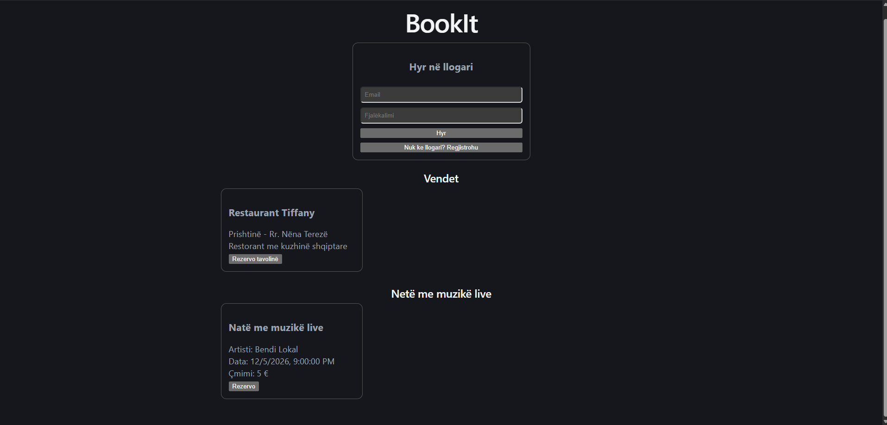
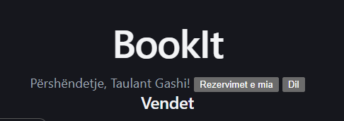
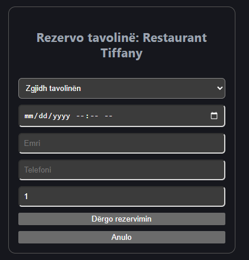
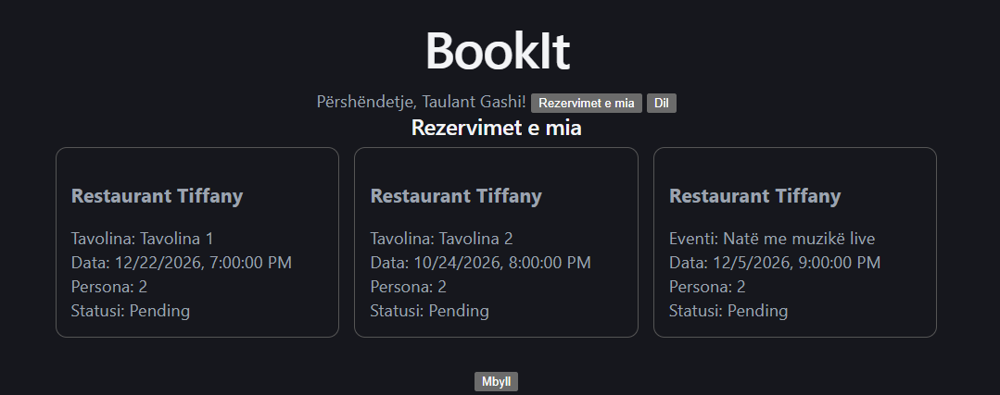

# BookIt

A full-stack reservation platform for restaurants and cafes with live music nights. Customers can browse venues and events, book a table or seats at an event, and manage their own reservations. The backend enforces real booking rules (capacity, double booking, available seats).

Built as a personal portfolio project with **ASP.NET Core**, **SQL Server** and **React**.

## Features

- Browse venues and upcoming live music events
- Reserve a **table** at a venue (choose table, date and time, number of guests)
- Reserve **seats** at a live music event
- User registration and login with **JWT** authentication
- "My reservations" page showing only the logged-in user's bookings
- Clear error messages returned by the API and shown in the UI

## Screenshots

### Home


### Login


### Table reservation


### My reservations


## Tech stack

**Backend**
- C# / ASP.NET Core Web API (.NET 10)
- Entity Framework Core (Code First, migrations)
- SQL Server (LocalDB)
- JWT authentication, BCrypt password hashing
- Swagger (Swashbuckle) for API documentation and testing

**Frontend**
- React (Vite) with JavaScript
- Hooks (`useState`, `useEffect`), `fetch` API
- Plain CSS

## Business rules

The rules are implemented on the server, so they cannot be bypassed from the UI:

- A table reservation cannot exceed the table's **capacity**
- The same table cannot be booked twice at the **same date and time** (cancelled reservations are ignored)
- An event reservation is rejected if there are **not enough seats left** (`TotalSeats` minus already booked guests)
- Reservations **in the past** are rejected
- The venue, table and event referenced by a reservation must exist, otherwise the API returns a clear message
- The reservation owner comes from the **JWT token**, never from the request body
- Passwords are stored only as **BCrypt hashes**, and emails are unique

## Data model

`Venue` 1 — * `Table`, `Venue` 1 — * `Event`, `Venue` 1 — * `Reservation`.
A `Reservation` belongs to a `Venue` and a `User`, and references either a `Table` or an `Event`.

## API overview

| Area | Endpoints |
|---|---|
| Auth | `POST /api/Auth/register`, `POST /api/Auth/login` |
| Venues | `GET`, `GET /{id}`, `POST`, `PUT /{id}`, `DELETE /{id}` on `/api/Venues` |
| Tables | same CRUD on `/api/Tables` |
| Events | same CRUD on `/api/Events` |
| Reservations | `GET`, `GET /{id}`, `POST` (requires login), `GET /my` (requires login), `PUT /{id}`, `DELETE /{id}` on `/api/Reservations` |

Full interactive documentation is available in Swagger at `/swagger` when the API is running.

## Project structure

```
BookIt/
├── BookIt.Api/        # ASP.NET Core Web API (controllers, models, EF Core, migrations)
├── bookit-web/        # React frontend (Vite)
├── docs/screenshots/  # Images used in this README
└── README.md
```

## Getting started

### Prerequisites
- [.NET SDK](https://dotnet.microsoft.com/download) (10)
- [Node.js](https://nodejs.org/) (LTS)
- SQL Server or SQL Server LocalDB

### 1. Clone the repository
```bash
git clone https://github.com/Taulanttg/BookIt.git
cd BookIt
```

### 2. Backend
```bash
cd BookIt.Api
```

Set the JWT signing key with .NET User Secrets (use any random string of at least 32 characters):
```bash
dotnet user-secrets init
dotnet user-secrets set "Jwt:Key" "replace-with-your-own-long-random-secret-key"
```

Check the connection string in `appsettings.json` (the default points to LocalDB), then create the database:
```bash
dotnet tool install --global dotnet-ef
dotnet ef database update
```

Run the API:
```bash
dotnet run
```
The API runs at `https://localhost:7212` and Swagger at `https://localhost:7212/swagger`.

### 3. Frontend
In a second terminal:
```bash
cd bookit-web
npm install
npm run dev
```
Open `http://localhost:5173`.

The API address is defined at the top of `src/App.jsx` and `src/Auth.jsx` (`https://localhost:7212/api`). If your API runs on a different port, change it there.

## What I learned

- Designing a relational model with EF Core and evolving it with migrations
- Implementing business rules on the server and returning meaningful errors
- Authentication with JWT and password hashing, and protecting endpoints
- Connecting a React frontend to a .NET API (CORS, `fetch`, auth headers)
- Debugging foreign key, validation and configuration errors

## Possible improvements

- Role-based authorization (owner and admin roles to manage venues, tables and events)
- DTOs and pagination for the API responses
- Cancel a reservation from the UI
- Automated tests (xUnit) and a CI pipeline
- Docker setup and deployment

## Author

**Taulant Gashi**
GitHub: [@Taulanttg](https://github.com/Taulanttg)
